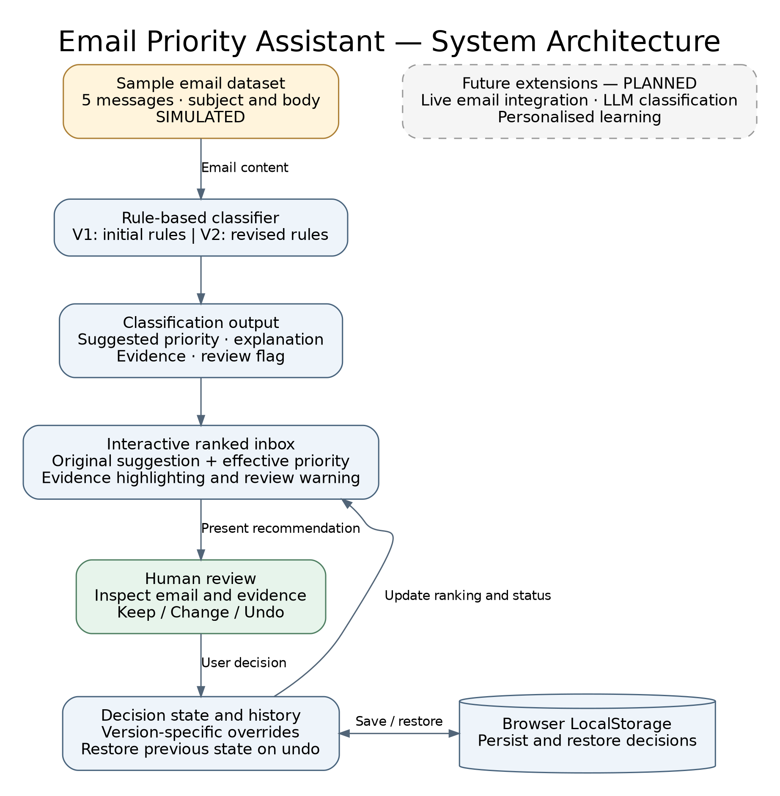
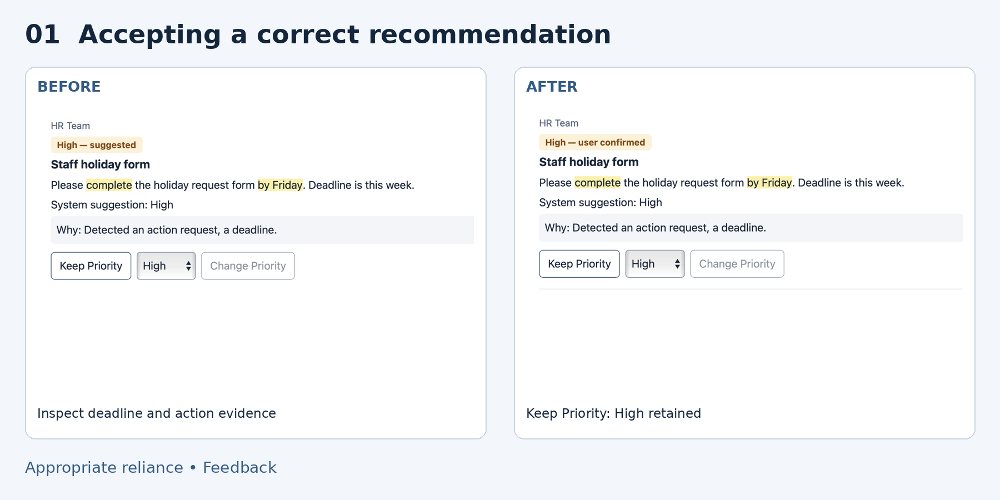
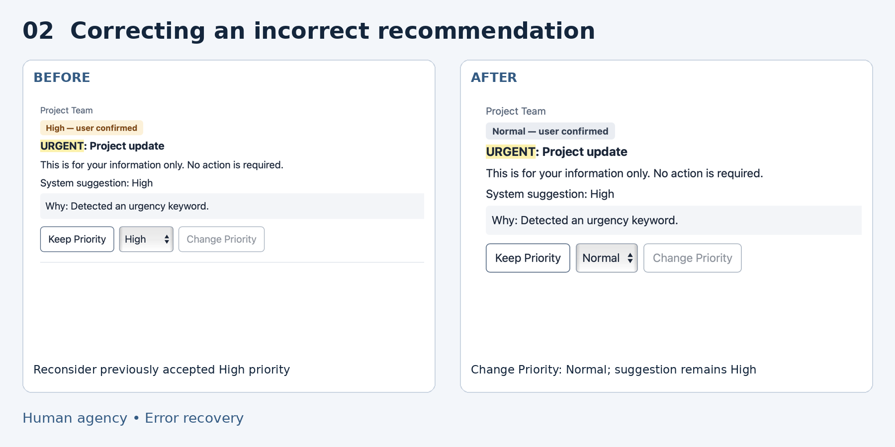
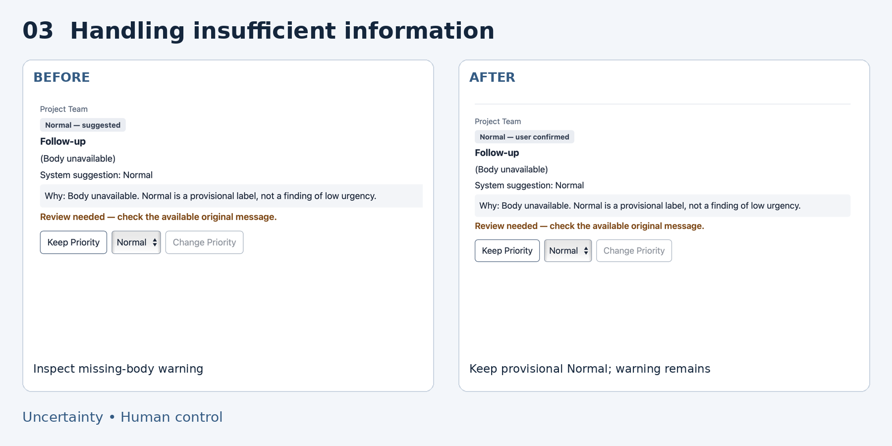

# Email Priority Assistant

README prose word count: 661 (approximate; excludes headings, tables, code, links and file paths).

## Project overview

This Intelligent Interactive Systems Assignment 2 prototype helps users decide which emails to read first while retaining control over priority decisions. It exposes the reasons and source evidence behind recommendations, supports correction and makes missing information visible. Its design explores appropriate reliance rather than automatic acceptance of system advice.

## Implementation status

- **Implemented:** executable V1 and V2 rule-based classifiers, High/Normal ranking, explanations, evidence highlighting, review warnings, Keep Priority, Change Priority, version-specific decision history, undo and browser-local persistence.
- **Simulated:** five fictional emails, including four Lab 3 examples and one missing-body case. No real mailbox is connected.
- **Planned:** live mailbox integration, LLM-based classification and personalised learning. None is implemented.

## Technology and setup

The application uses HTML, CSS and vanilla JavaScript. Browser LocalStorage stores review events. No external packages, API keys or backend are required.

Download or clone this repository and open `index.html` in a modern browser. For a consistent local origin and more reliable storage, optionally run the following command from the repository root (requires Python 3):

```sh
python3 -m http.server 8000
```

Open [http://localhost:8000](http://localhost:8000). V2 is selected initially. Switch between rule versions, inspect the email and explanation, retain its current priority or select a different priority and apply the change. The inbox reorders automatically. Review history and Undo last review apply to the selected version. If storage is unavailable, changes are session-only.

## System architecture



The classifier matches subject and body text; the sender is displayed but does not affect classification. V1 detects urgency, action and deadline signals. V2 additionally handles explicit no-action text and missing bodies. A missing body receives a provisional Normal label and a review warning. The interface preserves the original recommendation alongside the effective priority. Review events update the interface, not the classifier.

## Interaction storyboards

### Accepting a justified recommendation


### Correcting an incorrect recommendation


### Handling insufficient information


These screenshots illustrate prototype interactions, not observations from a participant study.

## Development record

- **Lab 3:** developed a manual Markdown simulation. A misleading urgent subject motivated a revised rule that considers explicit no-action text. The original specification and simulation are retained in `docs/`.
- **Initial prototype (`b9bf39d`):** separated the sample data and browser interface into executable files and added a missing-body example to explore fallback behaviour.
- **Classifier refinement (`d6e98c7`):** implemented both rule versions to make the design change comparable. Added explanations, evidence and review flags. Automated assertions checked expected priorities and source evidence.
- **Human review (`a5ffc60`):** added explicit decisions, effective-priority sorting, local persistence, version-specific history and undo. This preserves human agency and supports error recovery without silently changing the original recommendation. Browser checks verified these interactions.
- **Architecture (`fc97793`):** documented the classification and human feedback loop, separating simulated data, implemented components and planned extensions.
- **Storyboards (`6da6771`):** documented three interaction scenarios using screenshots from the running prototype.

## Testing and validation

Run the classifier tests from the repository root with Node.js (tested by the student using v22.23.5):

```sh
node tests/classifier.test.js
```

Expected output:

```text
All classifier assertions passed (5 emails, both versions, review flags and evidence).
```

The student ran the assertions twice successfully. The tests were also rerun successfully during the final source review. The following functional checks were supported by screenshots, automated assertions and student-reported manual browser testing:

| ID | Check | Result |
| --- | --- | --- |
| T01 | Expected sample classifications | PASS |
| T02 | V1/V2 classification difference | PASS |
| T03 | Missing-body review warning | PASS |
| T04 | Keep Priority | PASS |
| T05 | Change Priority | PASS |
| T06 | Original recommendation retained | PASS |
| T07 | Automatic priority sorting | PASS |
| T08 | Review history | PASS |
| T09 | Persistence after refresh | PASS |
| T10 | Undo latest decision | PASS |
| T11 | Version isolation | PASS |
| T12 | Same-priority change disabled | PASS |

These checks establish expected behaviour for the tested cases only. No participant study or real-world accuracy evaluation was conducted.

## Limitations and future work

The classifier uses narrow English keyword patterns and cannot reliably interpret arbitrary messages, nuanced negation or contextual deadlines. The sample dataset is small. User decisions are local to a browser and do not train or adapt the classifier. Undo removes the latest event for the selected version; history is not an immutable audit log. Future work could evaluate broader email cases, improve uncertainty handling and investigate appropriate reliance with users.

## AI assistance

ChatGPT assisted substantially with planning, code generation and revision, classifier tests, documentation, architecture diagram and storyboard layout. The student supplied the Lab 3 materials, ran the application and tests locally, performed manual interaction checks, captured screenshots and managed Git commits. The final README was drafted with ChatGPT using the submitted source archive and reported test results. No live AI service is used by the prototype itself.

## Repository structure

- `index.html`, `style.css`: interface and styling.
- `emails.js`: fictional email dataset.
- `classifier.js`: executable classification rules.
- `app.js`: rendering, decisions, storage and undo.
- `tests/`: classifier assertions and test notes.
- `docs/01_SPEC.md`, `docs/Markdown.md`: historical Lab 3 materials, not descriptions of the final implementation.
- `docs/system-diagram.*`: architecture diagram and editable source.
- `docs/storyboards/`: three interaction storyboards.
